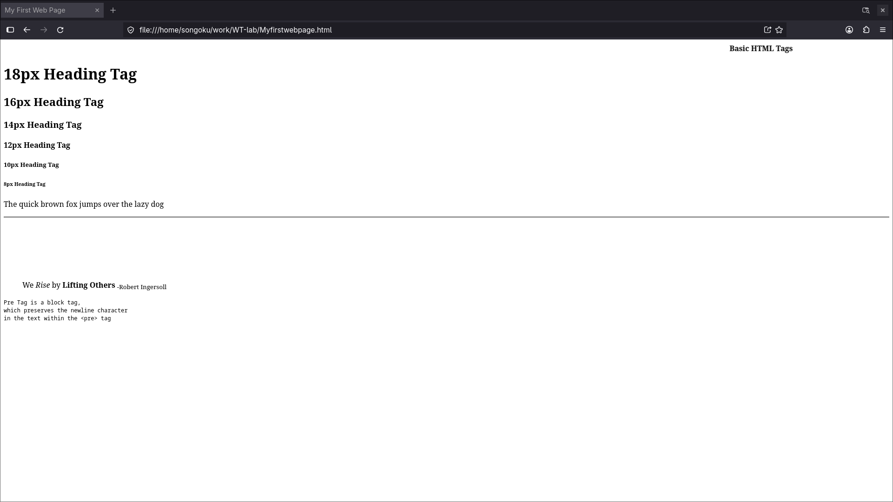
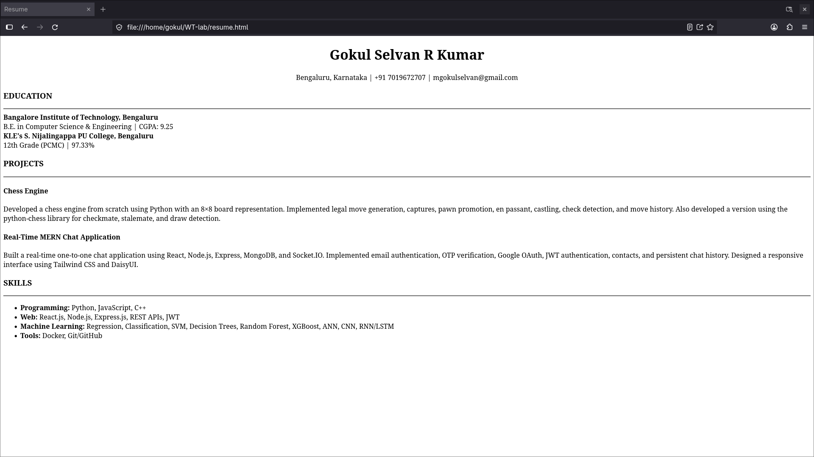
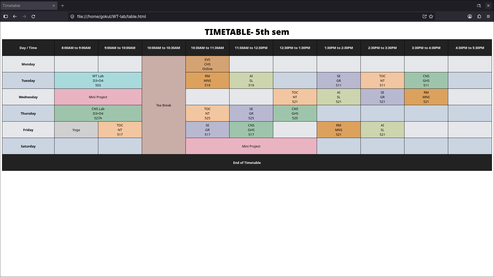
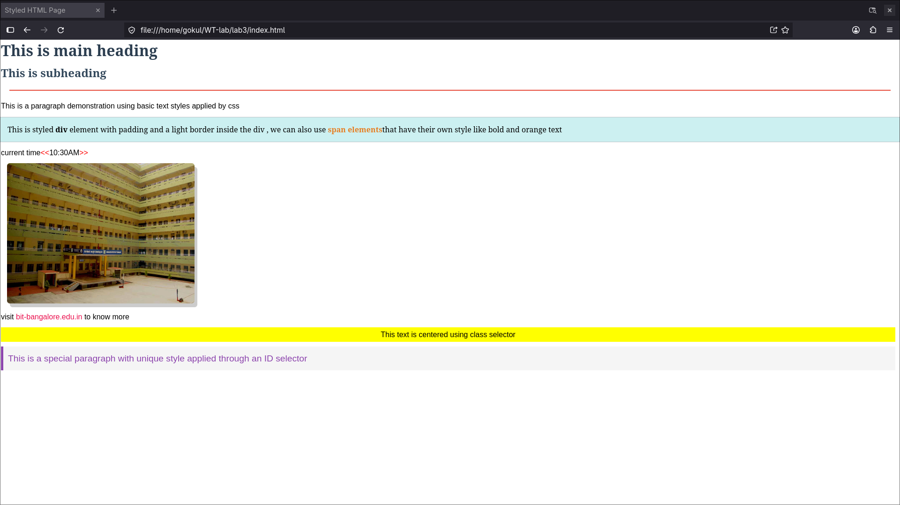
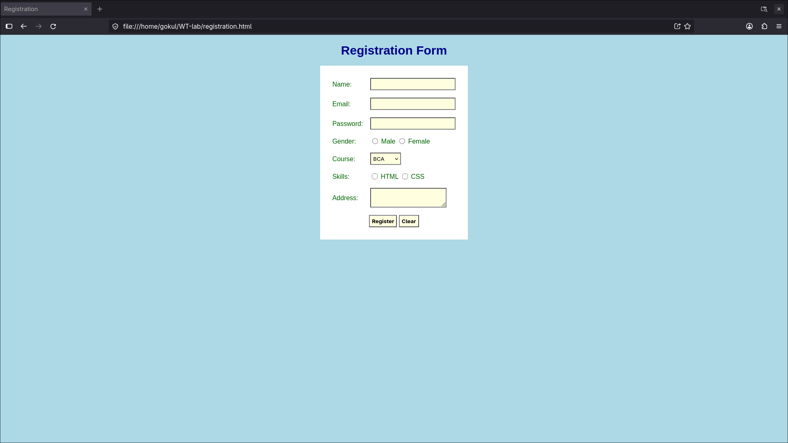
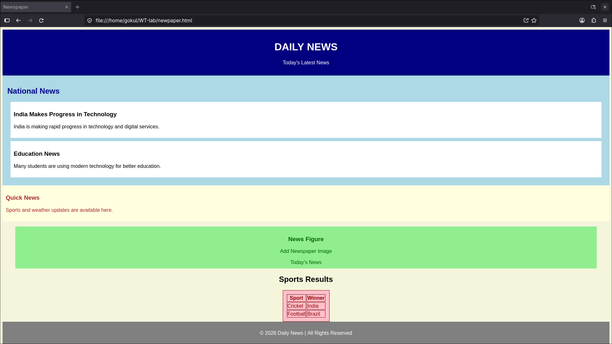

# Outputs

## sample HTML 1:

## Lab 1:

## Lab 2:

## Lab 3:

## Lab 4:

## Lab 5:

ssh-keygen -t ed25519 -f ./github_key
git config --local core.sshCommand "ssh -i ./github_key -o IdentitiesOnly=yes"
git config --local --unset core.sshCommand
